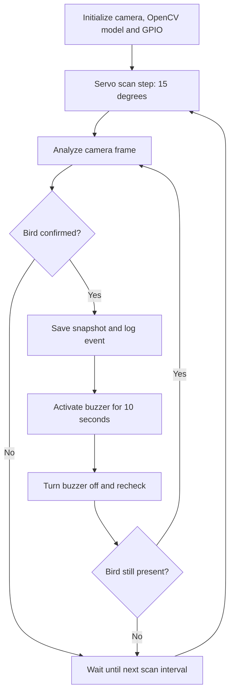

# Automated Bird Deterrent System

**Raspberry Pi 5 · Python · OpenCV DNN · MobileNet SSD · GPIO Zero · Embedded Systems**

A camera-based prototype that detects birds and triggers a timed acoustic deterrent while scanning the environment with a servo motor. Developed as a **team-based course project at New York University (NYU)**.

## What it does

- Captures live video from a USB camera attached to a Raspberry Pi 5.
- Performs object detection with a pretrained Caffe MobileNet SSD model through OpenCV; keeps only detections classified as `bird`.
- Requires two consecutive positive frames by default before triggering an event.
- Scans in commanded **15-degree steps at approximately 2-second intervals**, subject to motor settling and processing time.
- On detection, saves a snapshot and activates the buzzer for **10 seconds**; then checks again before resuming the scanning cycle.
- Saves timestamped events to `results/events.csv` for debugging and future evaluation.

> **Prototype status:** The team reported successful bird-detection and component-integration tests. No independently verified precision/recall, timing distributions, 360° coverage, outdoor durability, or battery runtime metrics are claimed. The VEX-battery-powered Raspberry Pi setup was not validated; use a correctly rated Raspberry Pi power supply.

## Prototype visuals

The project includes a working bench prototype, Fusion CAD enclosure views, and an acrylic enclosure photograph. Photos and CAD renders are available in the accompanying project package and will be added to the repository's `hardware/` directory after binary upload.

See [hardware documentation](docs/hardware.md) for hardware notes.

## System flow



## Setup on Raspberry Pi OS

Requires a Raspberry Pi 5, working USB camera and suitable independently verified power/driver circuits for external actuators. Test detection without GPIO before attaching any powered hardware.

```bash
sudo apt update
sudo apt install -y python3-opencv python3-numpy python3-gpiozero python3-lgpio curl
bash download_model.sh
python3 Bird_Deterrent.py --dry-run
```

The model downloader obtains the pretrained Caffe network architecture and weights into the local `models/` folder. This repository does **not** include third-party model weights.

Once the hardware is verified, for a *positional servo* and *active DC buzzer with appropriate transistor driver*:

```bash
python3 Bird_Deterrent.py --servo-mode positional --buzzer-type active
```

Use `python3 Bird_Deterrent.py --help` to inspect all available options. The program also supports `--headless`, an alternative camera `--source`, confidence thresholds, scan interval, and other parameters. Exit with `q` in the preview window or `Ctrl+C` in the terminal.

## Repository contents

```text
Bird_Deterrent.py        Camera detection, GPIO scanning and alarm state logic
download_model.sh        Model download utility
 hardware/               Photos and CAD renders (pending image upload)
 docs/hardware.md        Wiring and power safety notes
 docs/testing.md         Suggested reproducible experiments
 results/.gitkeep        Empty directory placeholder (generated logs excluded)
```

## Hardware and safety

The Raspberry Pi GPIO control signals are BCM **GPIO17** (physical pin 11) for the servo and **GPIO27** (physical pin 13) for the buzzer switch circuit. All control circuits require a common ground. A two-wire 3–24V buzzer must not be powered directly from a Pi GPIO; use an appropriately rated transistor driver and protection. The team used a TIP120 NPN Darlington transistor in prototyping, not a MOSFET. Verify the servo's actual rated voltage, current draw, and motor type before use. See [hardware notes](docs/hardware.md).

The nominal 7.2V VEX pack must **never** be connected directly to Raspberry Pi GPIO or 5V pins. The LM2596 HW-411 module alone is not a verified Pi 5 supply. Never operate an unmeasured adjustable regulator connected to the Pi.

## Limitations and next steps

- The pretrained general-purpose detector may misclassify unusual birds, small birds, or challenging lighting conditions.
- `--dry-run` simulates both actuators, so its logs are not evidence of physical movement or sound.
- The positional-servo implementation sweeps back and forth within its configured range rather than providing full 360° coverage.
- Test and report real precision, recall, false positives, trigger latency, angular accuracy, and power stability (see [test plan](docs/testing.md)).
- Add integration tests, a reproducible headless service, and validated battery power before outdoor deployment.

## Project background

This repository documents a **team-based course project at New York University (NYU)**, including the working prototype, computer vision implementation, hardware integration, and enclosure design. It is maintained as a technical project record and portfolio showcase.

**External references:** [Hobby Project bird photography tutorial](https://hobby-project.com/arduino-raspberry-pi/automatic-bird-photography-with-open-cv-object-recognition/), [pretrained MobileNet SSD source](https://github.com/djmv/MobilNet_SSD_opencv), [GPIO Zero](https://gpiozero.readthedocs.io/en/stable/).

**License:** Not specified yet; confirm agreement from all team members before choosing an open-source license.