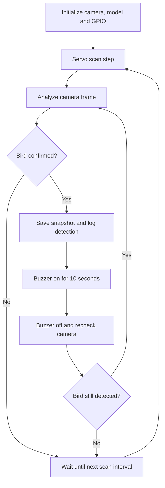

# Automated Bird Deterrent System

**Computer Vision · Edge AI · Python · Raspberry Pi 5 · Embedded Systems**

**Personal technical portfolio | NYU project**

This NYU course project combines real-time computer vision, Raspberry Pi GPIO control, servo-based scanning, and automated buzzer activation. The repository showcases the Python implementation, embedded-system architecture, prototype integration, and technical problem-solving involved in building the system.

## Technical highlights

- **Computer vision:** Run a pretrained Caffe MobileNet SSD detector using OpenCV DNN on frames from a USB camera; filter predictions to the `bird` class.
- **Detection logic:** Apply a configurable confidence threshold and require consecutive positive frames before confirming a detection.
- **Embedded control:** Interface Python with Raspberry Pi GPIO to drive positional servo scan steps and an externally driven DC buzzer.
- **Event-driven automation:** Trigger a 10-second buzzer cycle, recheck the scene, and resume scanning when the detected bird is no longer present.
- **Data collection:** Save annotated detection snapshots and timestamped CSV events for debugging and future performance evaluation.
- **Physical prototyping:** Integrate electronics with a CAD-designed enclosure using acrylic panels and 3D-printed supports.

## System architecture

```text
USB Camera
    |
    v
Raspberry Pi 5
    |-- OpenCV DNN + pretrained MobileNet SSD
    |-- Bird detection / confirmation logic
    |-- GPIO17 --> Servo signal (scan)
    |-- GPIO27 --> TIP120 driver --> DC buzzer
    |
    +--> CSV event log + detection images
```

### Detection and control flow



## Implementation details

| Component | Implementation |
| --- | --- |
| Programming language | Python |
| Computer vision | OpenCV DNN, pretrained MobileNet SSD (Caffe) |
| Hardware platform | Raspberry Pi 5, USB webcam |
| Servo scan | 15° commanded steps, approximately 2 seconds apart |
| Confirmation | Two consecutive positive inference frames by default |
| Buzzer control | GPIO-triggered switch circuit; 10-second activation |
| Observability | Timestamped `results/events.csv` and detection snapshots |
| Enclosure | CAD design, acrylic housing, 3D-printed internal supports |

The positional-servo mode reverses at configured angle limits; it does **not** provide precise continuous 360° coverage.

## Prototype and validation

The camera-based detector was demonstrated on Raspberry Pi, and the team bench-tested control behavior. The software supports both a vision-only simulation mode (`--dry-run`) and GPIO hardware mode. Logs such as `BIRD_DETECTED`, `SERVO_STEP`, and `BUZZER_OFF` make the system's state transitions observable.

**Results not yet quantified:** I have not published verified precision, recall, false-positive rates, end-to-end latency distributions, angular calibration results, or outdoor runtime data. Showing a bird image to the camera is an initial functional check, not a substitute for a labeled evaluation dataset.

### Design documentation

CAD and hardware photos are available in the associated project materials; repository image uploads are pending. See [hardware notes](docs/hardware.md) and the [test plan](docs/testing.md).

## Run locally on Raspberry Pi OS

```bash
sudo apt update
sudo apt install -y python3-opencv python3-numpy python3-gpiozero python3-lgpio curl
bash download_model.sh

# Preview detection without accessing GPIO
python3 Bird_Deterrent.py --dry-run
```

After confirming correct power regulation, actuator ratings, common ground, and the buzzer driver circuit:

```bash
python3 Bird_Deterrent.py --servo-mode positional --buzzer-type active
```

Press `q` in the camera preview or `Ctrl+C` in the terminal to stop. Additional options are available with `python3 Bird_Deterrent.py --help`; `--headless` disables the preview window.

## Repository structure

```text
Bird_Deterrent.py        Main vision and control application
download_model.sh        Download pretrained model configuration and weights
requirements.txt         Python environment notes
docs/hardware.md        Wiring and power considerations
docs/testing.md         Suggested experiments and evaluation metrics
models/                 Download target; model files are gitignored
results/                Generated logs and snapshots are gitignored
```

## Engineering considerations / next steps

- Build a labeled set of bird and non-bird images from varied distances and lighting conditions; report precision, recall, and false positives.
- Measure bird-confirmation-to-buzzer latency and actual servo step timing.
- Compare MobileNet SSD performance against a more recent lightweight detector.
- Calibrate servo motion and add integration tests for repeated detection and shutdown behavior.
- Validate safe, sufficiently rated power delivery before testing untethered outdoor operation.

**Power and wiring:** Raspberry Pi 5 uses 3.3V GPIO logic. Power supplies for the Pi and external actuators must meet their respective voltage and current requirements. See [hardware notes](docs/hardware.md).

## References

- [Bird-photography reference tutorial](https://hobby-project.com/arduino-raspberry-pi/automatic-bird-photography-with-open-cv-object-recognition/)
- [MobileNet SSD pretrained model](https://github.com/djmv/MobilNet_SSD_opencv)
- [GPIO Zero documentation](https://gpiozero.readthedocs.io/en/stable/)
